

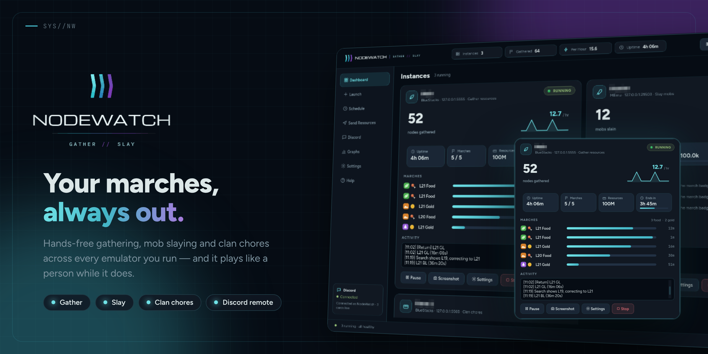

 

**[Features](#features)** &nbsp;·&nbsp; **[How it works](#how-it-works)** &nbsp;·&nbsp; **[Tour](#a-closer-look)** &nbsp;·&nbsp; **[Get started](#get-started)** &nbsp;·&nbsp; **[Discord](#your-discord-remote)** &nbsp;·&nbsp; **[FAQ](#faq)**

 

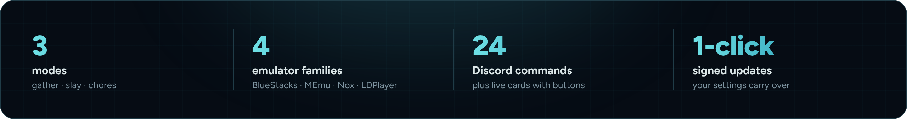

 

## Features

<table>
<tr>
<td width="33%" valign="top">

#### Gather Resources
Keeps every march slot out on the resource, level and biomes you choose. A level comes up empty? It drops a level, then follows your **pivot order** — or stays on target if you set it to **Off**.
</td>
<td width="33%" valign="top">

#### Watcher
When the in-game search finds nothing nearby, **Watcher** finds a full Food or Gold node further out on supported realms and travels there by coordinates — never to a node one of your own marches is already on.
</td>
<td width="33%" valign="top">

#### Slay Mobs
Finds a mob at your level, checks its name and level **before** committing troops, and sends your marches as fast as the game allows. Set a brew limit and it stops before going over.
</td>
</tr>
<tr>
<td valign="top">

#### Clan Chores
Clears mob chests and helps the clan in any mode — or run **Clan Chores Only**, which closes the game between visits and times the next one by how fast your tavern fills.
</td>
<td valign="top">
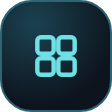

#### As many instances as your PC can run
BlueStacks, MEmu, Nox and LDPlayer, side by side. Each gets its own mode, settings and live card. Settings are remembered per emulator; **Copy to all** sets up the rest.
</td>
<td valign="top">

#### Plays like a person
No two taps land in the same spot. Timing varies, swipes curve, typing has a rhythm, and it slows with fatigue over a long session — then takes real breaks with the game closed.
</td>
</tr>
<tr>
<td valign="top">

#### Checks before it acts
Looks at the screen after every tap, reads the node before sending, and recovers from popups, the city view and disconnects. **Auto Shield** keeps you covered — and never buys one.
</td>
<td valign="top">

#### Discord remote
A live card per instance in your own server, with buttons. Start, stop, edit settings, pop a shield, grab a screenshot — all from your phone. Alerts arrive with a picture.
</td>
<td valign="top">

#### Schedules
Start instances at set times — opening the emulator first if it's closed — and stop and close them at another. Every day, or only the days you pick.
</td>
</tr>
<tr>
<td valign="top">

#### Send Resources
Move food, gold or ore from an idle account to any castle. It goes to the coordinates and **reads the castle's name** first — no match, nothing is sent.
</td>
<td valign="top">
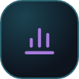

#### Graphs
Every march is counted as it comes home — nodes and the resources they brought back — by day, by week and by instance.
</td>
<td valign="top">

#### Signed updates
New versions install in one click and keep your settings. Every release is signed, so it only ever installs one that really came from here.
</td>
</tr>
</table>

 

## How it works

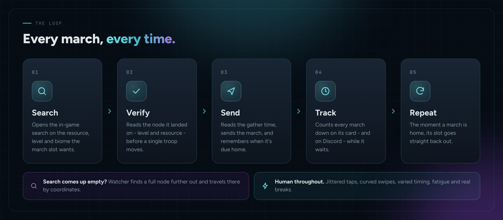

NodeWatch drives each emulator over ADB and reads the game's own screen — matching what it sees and reading the numbers the game displays. There's no memory reading and no network tampering; it only ever taps and swipes, like you would. Your mouse stays yours, so you can keep using your PC while it runs.

 

## A closer look

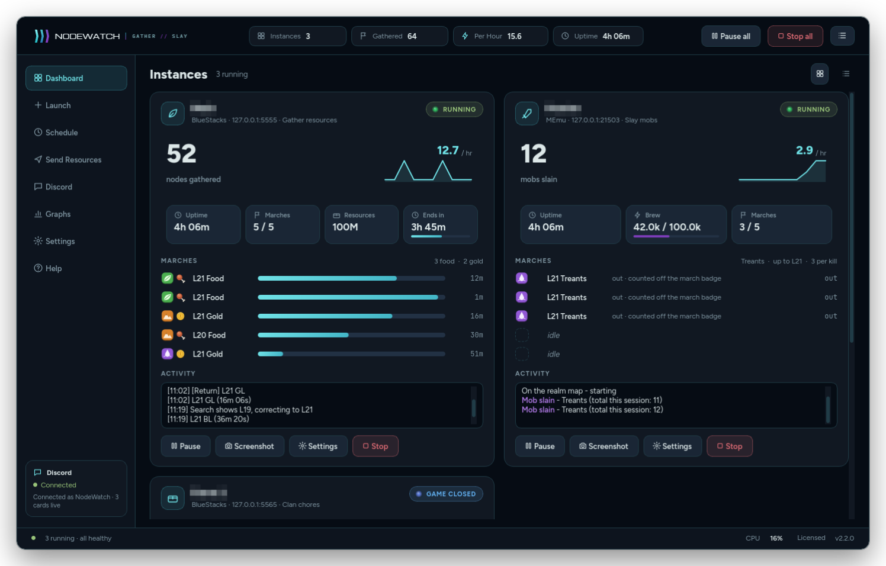

<b>The dashboard</b> — one card per instance: what it's doing, its rate, every march counting down, and what it's brought home.

<table>
<tr>
<td width="50%" align="center" valign="top">
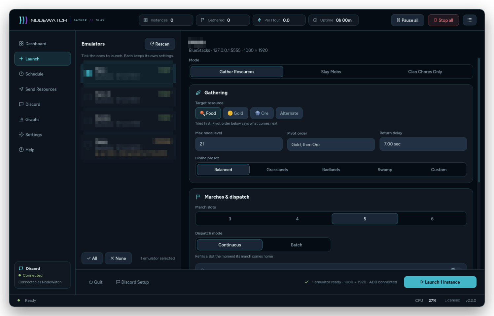 
<b>Launch</b> — tick your emulators, pick a mode, go.
</td>
<td width="50%" align="center" valign="top">
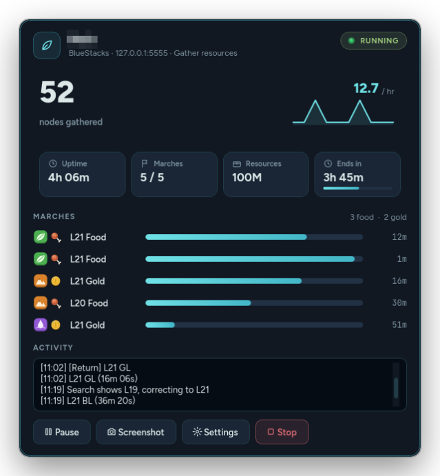 
<b>A gathering card</b> — rate, uptime, resources and every march.
</td>
</tr>
<tr>
<td align="center" valign="top">
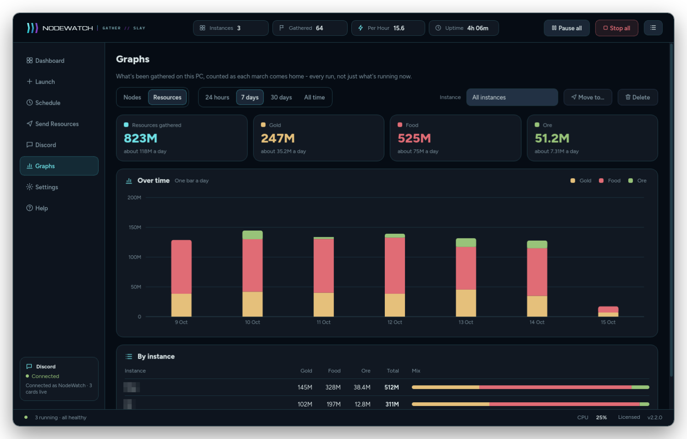 
<b>Graphs</b> — what came home, by day and by instance.
</td>
<td align="center" valign="top">
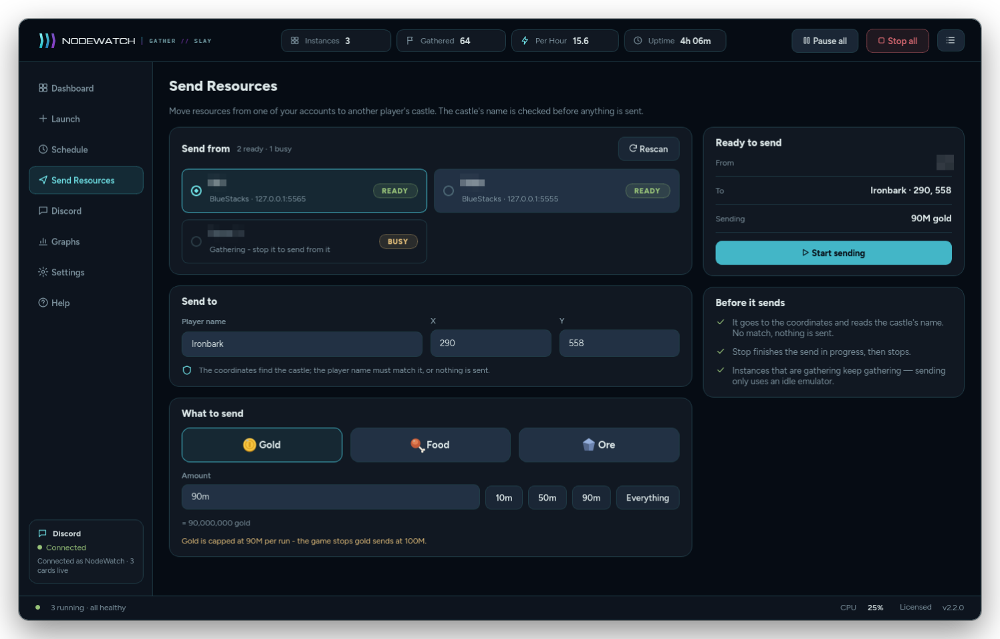 
<b>Send Resources</b> — checked against the castle's name first.
</td>
</tr>
<tr>
<td align="center" valign="top">
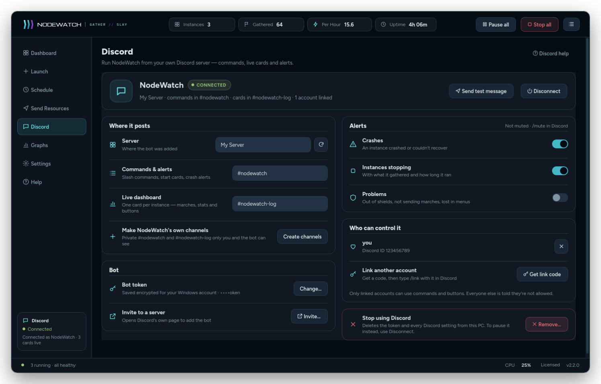 
<b>Discord</b> — your own bot, your own server, set up in a few clicks.
</td>
<td align="center" valign="top">
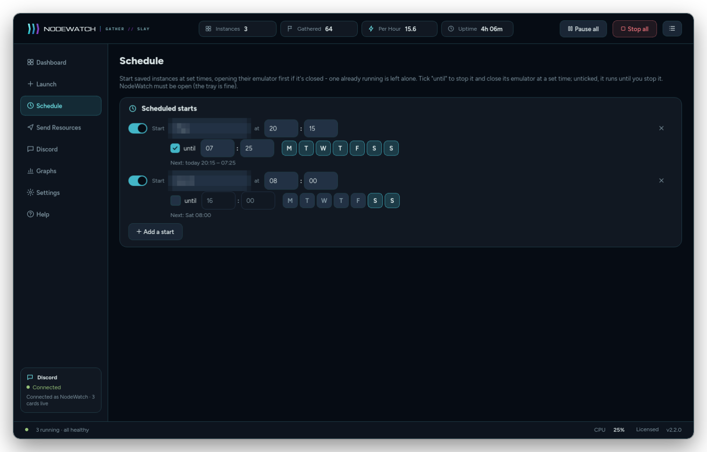 
<b>Schedule</b> — start and stop on your timetable.
</td>
</tr>
<tr>
<td align="center" valign="top">
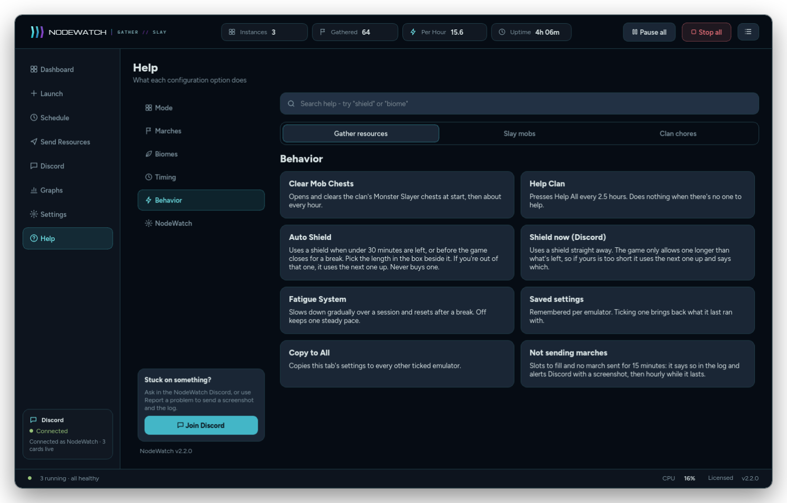 
<b>Help</b> — every setting explained, searchable, right in the app.
</td>
<td align="center" valign="top">
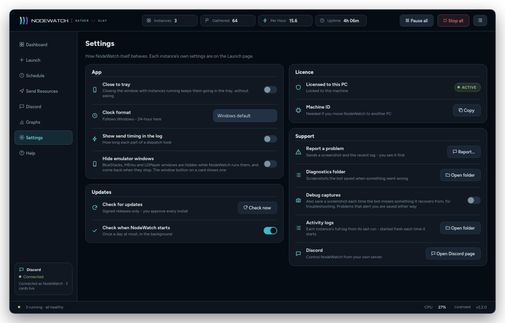 
<b>Settings</b> — tray, clock, updates, licence and support.
</td>
</tr>
</table>

 

## Get started

<table>
<tr>
<td width="33%" valign="top">

**1 &nbsp;Download**

Grab **`NodeWatch-Setup-<version>.exe`** from the [latest release](https://github.com/dberry03/Nodewatch/releases/latest).
</td>
<td width="33%" valign="top">

**2 &nbsp;Install**

Run it. It installs just for your Windows account — no admin rights needed.
</td>
<td width="33%" valign="top">

**3 &nbsp;Activate**

Open NodeWatch and paste your licence key. Each key works on one PC.
</td>
</tr>
</table>

> [!IMPORTANT]
> Set every emulator instance to **1080 × 1920 portrait** in its display settings. NodeWatch won't launch an instance at any other resolution — it wouldn't be able to recognise anything on screen.

| | Requirement |
|---|---|
| **Windows** | 10 or 11, 64-bit |
| **Emulator** | BlueStacks 5, MEmu, Nox or LDPlayer, with ADB enabled |
| **Resolution** | 1080 × 1920 portrait, on each instance |
| **Discord** *(optional)* | A free bot you create yourself — NodeWatch walks you through it |

Then: tick your emulators on **Launch**, choose a mode for each, and press **Launch**. Hover any setting for a tip, or open **Help** for the full guide.

 

## Settings at a glance

<b>Gathering</b>

 

| Setting | What it does |
|---|---|
| **Target resource** | Food, Gold, Ore — or Alternate between food and gold |
| **Max node level** | The highest level it searches; drops up to two levels when nothing's there |
| **Pivot order** | What to gather when the target isn't there. **Off** never pivots |
| **Return delay** | A few extra seconds before a march is expected home |
| **Biome preset** | Spread across every biome, stick to one, or choose per march |
| **March slots** | How many marches your account can have out (3 to 6) |
| **Dispatch mode** | *Continuous* refills a slot the moment its march is home. *Batch* sends them all, waits for all of them, then repeats |
| **While waiting** | In Batch, close the game while marches are out — or stay on the map |
| **Dynamic reassignment** | Moves a march to another biome when its own runs dry |
| **Watcher** | When the search finds nothing, sends the march to a full Food or Gold node further out. Needs your realm and your castle's X and Y |

<b>Mob slaying</b>

 

| Setting | What it does |
|---|---|
| **Max mob level** | The highest level it looks for (1 to 21); drops up to two levels when nothing's there |
| **Hunt biome** | Grasslands, Badlands or Swamp — each has its own mob |
| **Marches per kill** | How many marches a kill takes you. Three suits most accounts |
| **Brew limit** | Stops before spending more than this. 0 means no limit |

<b>Every mode</b>

 

| Setting | What it does |
|---|---|
| **Clear Mob Chests** | Clears the clan's mob chests at the start, then about once an hour |
| **Help Clan** | Presses Help All every couple of hours |
| **Auto Shield** | Puts up a shield of your chosen length when yours is nearly out, or before a break. Never buys one |
| **Stop after** | Stops after the hours you set |
| **Break every** | Closes the game for an hour or two every few hours |
| **Fatigue** | Slows down gradually over a long session |

 

## Your Discord remote

Discord is optional — NodeWatch works exactly the same without it. Open the **Discord** page and it walks you through creating your own bot, and can even make its own private channels. Then, from your phone:

| | |
|---|---|
| `/status` · `/panel` | What's running and how it's doing — or a control panel with buttons |
| `/start` · `/restart` · `/stop` | Start with saved settings (opening the emulator if needed), restart, or stop — now, or later with `after:2h` or `at:7am` |
| `/pause` · `/resume` | Pause or resume |
| `/settings` · `/edit` | See the settings `/start` will use, or change them with dropdowns |
| `/schedules` · `/schedule-edit` | Your scheduled starts and stops, and changes to them |
| `/log` · `/screenshot` · `/clear` | Recent activity, the screen right now, or clear a popup and see it |
| `/diagnostic` | The last problem it hit, with a picture |
| `/chests` · `/help-clan` · `/shield` | Do a chore now, or check your shield and use a new one |
| `/emulators` · `/open` · `/close` | See your emulators, open one, or stop and close one |
| `/mute` · `/link` · `/help` | Quiet alerts for a while, link another account, or see everything it can do |

Every running instance also keeps a **live card** in your channel — status, each march with its countdown, what it's brought home and the latest activity — with **Log**, **Screenshot**, **Settings**, **Pause**, **Stop** and **Quit** buttons. Anything that would stop an instance asks first. Only accounts you link can use it, and your bot token is stored encrypted.

 

## Privacy & trust

- **Nothing leaves your PC on its own.** Reports go only when you press Send in *Report a problem* — and you see exactly what's in them first. Nothing in them identifies you.
- **Debug captures are off by default.** Turn them on in Settings only if you're troubleshooting. Screenshots for problems that alert you are kept either way.
- **Updates are signed.** NodeWatch checks once a day, tells you when nothing's running, and refuses anything not signed for it. Your settings, saved instances and licence carry over.
- **Your licence is tied to your PC**, not an account. Moving PCs? Copy your machine ID from Settings and ask in the Discord.

 

## FAQ

<b>It says my emulator is the wrong resolution.</b>

 
Open that emulator's display settings, set 1080 × 1920 portrait, restart it, then press <b>Rescan</b> in NodeWatch.

<b>Which emulators does it work with?</b>

 
BlueStacks 5, MEmu, Nox and LDPlayer — NodeWatch finds them by the names you gave them, and can open, close and restart them (from Discord too). BlueStacks has had the most testing.  
On MEmu, set <b>Settings → Engine → Render mode</b> to <b>DirectX</b>. In OpenGL mode MEmu returns blank screenshots and NodeWatch can't see the game (it tells you if that's happening).

<b>What does Watcher need?</b>

 
Turn it on in the instance's <b>Chores &amp; safety</b> panel and enter your realm and your castle's X and Y — it tries the nearest full nodes first. It works on supported realms, says so if yours isn't one, and only steps in when the in-game search comes up empty.  
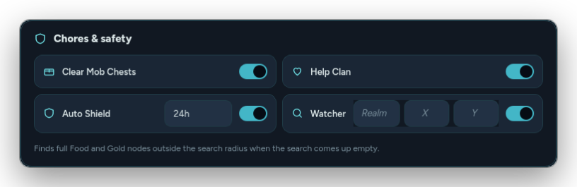

<b>Can I use my PC while it runs?</b>

 
Yes. It talks to the emulator directly instead of moving your mouse, so minimise everything — or turn on <b>Hide emulator windows</b> in Settings.

<b>I got a new PC and my key stopped working.</b>

 
Keys are tied to one PC. Copy your machine ID from <b>Settings</b> and ask in the <a href="https://discord.gg/HCs2wAwmsx">Discord</a> for a new key.

<b>Something's not working. How do I report it?</b>

 
Press <b>Report</b> on that instance's card, or <b>Settings → Report a problem</b>. You'll see exactly what gets sent before it goes. Or just ask in the <a href="https://discord.gg/HCs2wAwmsx">Discord</a>.

 

---

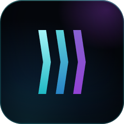
  
NodeWatch is an independent project and isn't affiliated with or endorsed by any game developer or publisher. Please use it within the rules of the games you play.

